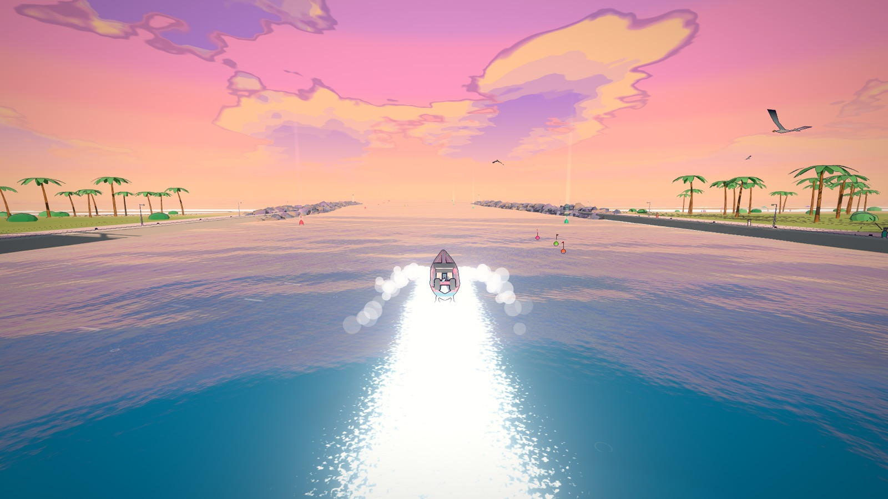
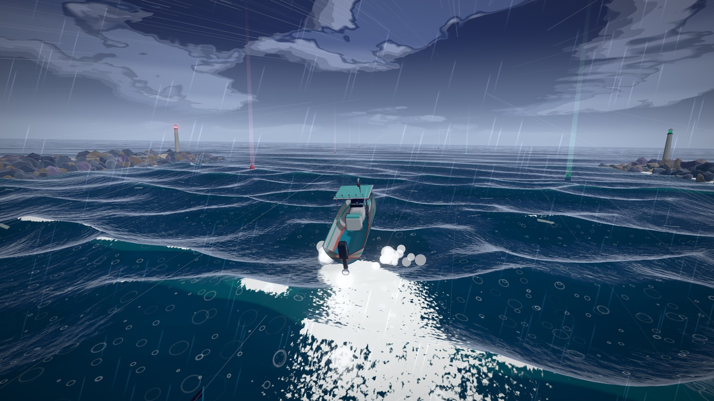
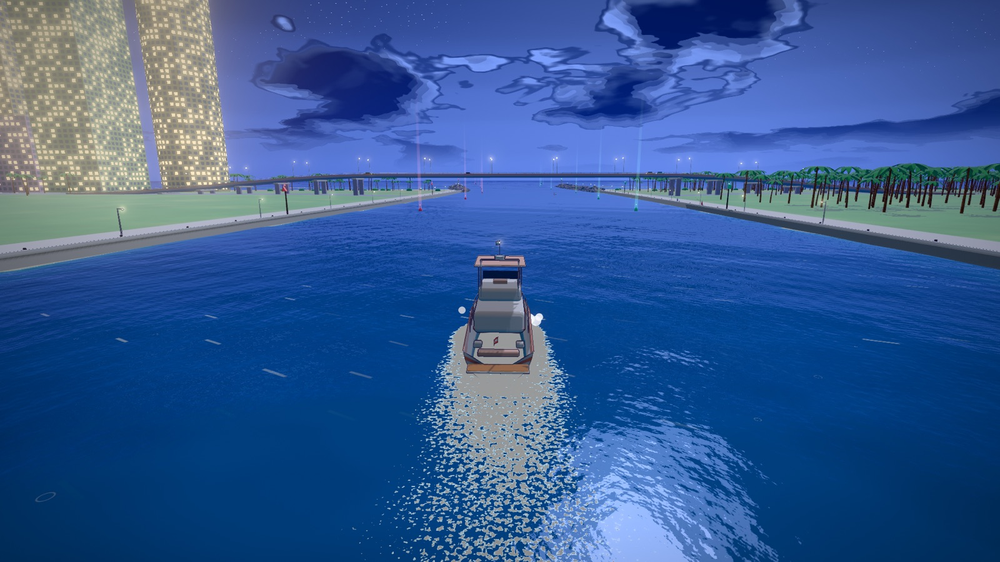
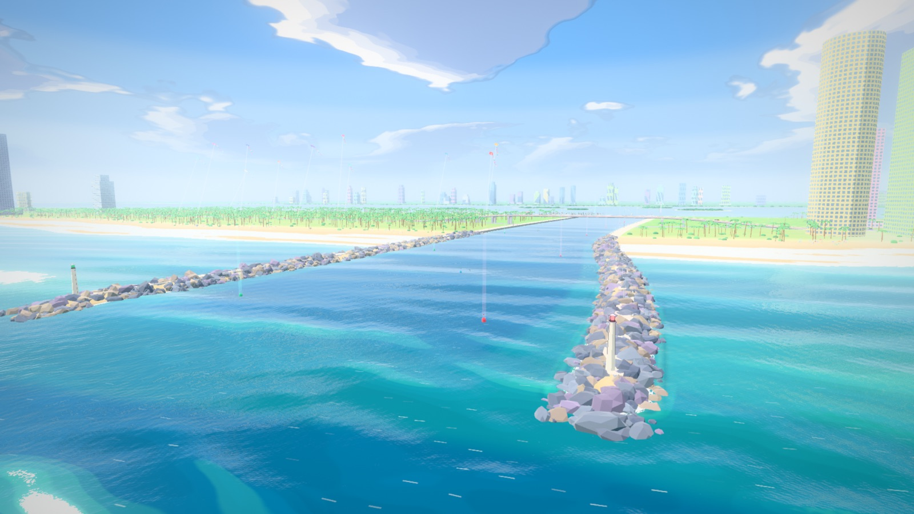
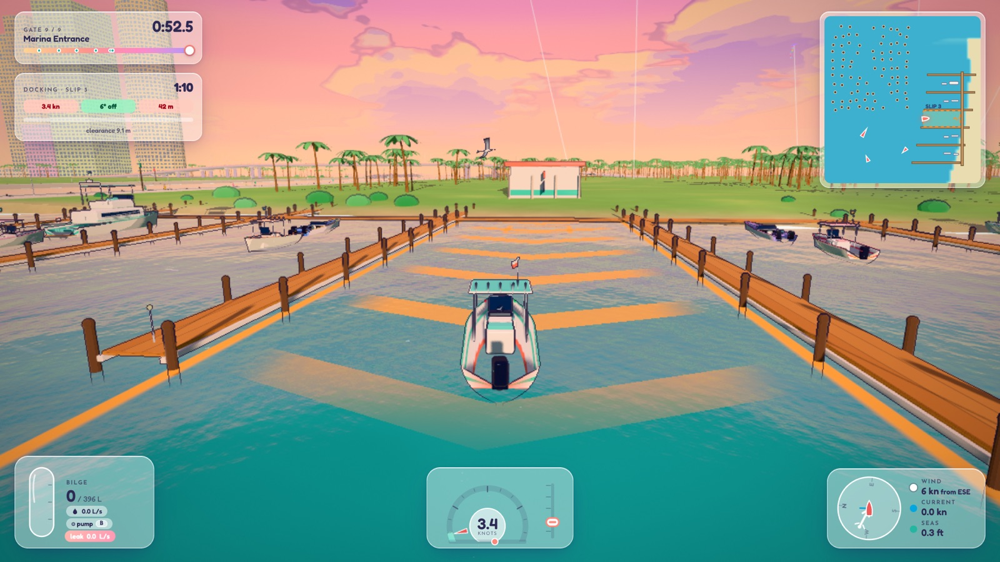
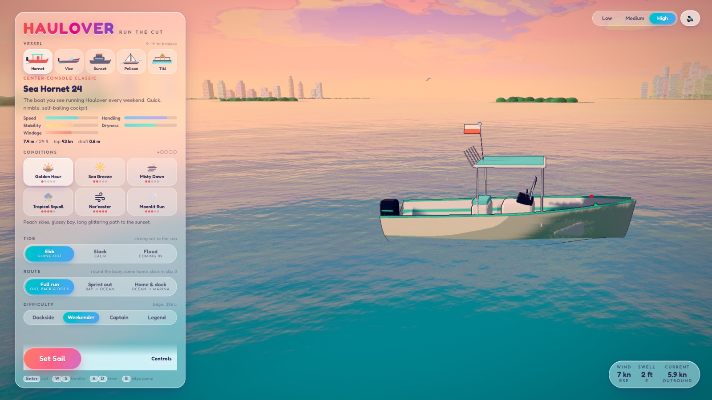
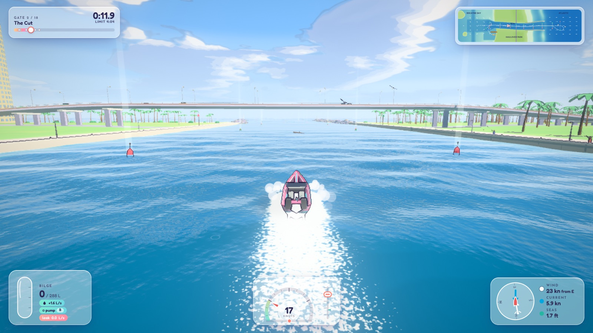

# Run the Cut

<p align="center">
  <strong>Physics-driven boating games on one pastel engine.</strong><br />
  <b>Haulover</b> — run the inlet, survive the sea, dock in the marina. &nbsp;·&nbsp;
  <b>Montauk</b> — find the bait, troll a spread, hook a tuna and keep it on. &nbsp;·&nbsp;
  <b>Nantucket</b> — the docking challenge <em>(coming soon)</em>.
</p>

<p align="center">
  
</p>

A title screen picks the game; each has its own menu, rules, scoring and best scores (`?game=haulover|montauk`).

### Haulover

Choose a boat, weather and tide, then run the narrow channel between Haulover's rock jetties. Round the sea
buoy, return through the inlet, avoid hazards and harbour traffic, and dock in your slip. Ship too much water,
let the sea break your hull or run out of time and the run is over.

### Montauk

*Landing a tuna is how you win.* It is dawn off Montauk Point, an easterly is leaning on the ebb, and you have a
few minutes of daylight to find the bait, get a spread of lures through it and keep a tuna on the line while the
crew reels. The wind and the tide **work against you the whole day and build as it goes**, and it is easy to lose
the fish if you do not captain properly.

| | |
|---|---|
| **Search** | Read the water. Terns and gannets diving on bait, white boils where tuna crash it, and a pale slick over bait that is not feeding right now. Hold `V` for binoculars (they double your range, tag what they see, and ignore the boat's motion). The **fish finder** shows the bait ball at its depth and tuna as arches beneath it, but only when you pass right over them. `T` marks a spot; the bait drifts with the tide, so the pin goes stale. Birds alone can be a decoy; boils mean tuna. Charge a school above ~10 kn through the water and it is spooked for a minute. |
| **Troll** | `L` sets four lines off the stern. The lures only work in a window of speed *through the water* (about 4.5–8 kn: too slow and they sink, too fast and they skip out). They trail along your **track through the water**, so a sharp turn swings the lines across each other and tangles them (a calm, straight 8 seconds clears it); backing down with lines out wraps the prop. A tuna takes a lure that is in front of it, at the right depth, when its school is feeding. |
| **Hook-up** | `FISH ON!` The strike sets the hook only at troll speed. Then you must **throttle back at once**: the line's tension rises with how fast it is paying out, so powering away from a fish parts the line. |
| **Fight** | A real tether between the boat and the fish, not a bar. The fish has a position, depth and velocity and its own moods (**run**, **sound**, **thrash**, **circle**, a last **dash** at the boat, **tired**), each announced about a second and a half ahead on the HUD. The line has a length out, a stretch, and a drag that slips when tension passes its setting (`Q` ease / `E` tighten). The crew reels by themselves, fast when the fish is inside the **stern cone** and the line is not at its limit, slower when it is off the quarter, and not at all when it is ahead of the beam. A fish held under tension tires (the **sweet zone** is the green band); too much and the line **snaps**, too little for too long and the **hook pulls**, a fish under the boat or along the hull **chafes** the line through, and a wave slam is a spike. `Z` pumps the rod (faster, riskier, tires the crew). Fish prefer to run **with the tide**, so you chase them into the rips. A tired fish alongside is gaffed when the boat is quiet and the fish is astern. |
| **Wind against tide** | Every Montauk sky blows an onshore easterly against the east-setting ebb, which stands the rips up (Cotton-Candy Dawn, Peach Fog Bank, Lilac Dusk, Rosé Nor'easter). Both build through the day (and the sky drifts to dusk), the boat's windage pushes it one way and the tide pushes it and the fish another, and the 45° wave rule from Haulover applies on the run out. The tide menu offers ebb or flood: there is no slack water here. |
| **Tiers** | Deckhand, Mate, Captain, Montauk Legend: how much daylight you get, how many schools there are and how many hold tuna, how often they show on the surface, how hard they fight (bluefin get likelier), how good the crew is, how fast the drag slips, how fast the sea builds, and how much water the boat can take. |
| **Scoring** | Weight × species value, a clean-fight bonus, daylight to spare, hull in one piece, minus lost fish and tangles, times the tier. One star for a tuna on the deck, three for a big clean fight. |

Built with **three.js WebGPU + TSL**, a hand-written boat physics engine and a fully procedural world. Waves,
hulls, palms, clouds, engine notes and music are generated at runtime—no model, texture or audio files required.
The game is a static single-page app that can be hosted on GitHub Pages.

## Play

To run locally, use Node.js **22.12 or newer**:

```bash
npm install
npm run dev
```

Open the local URL printed by Vite. The production build can be tested locally with `npm run build` followed by
`npm run preview`.

Best in a current Chrome, Edge or Safari 26 (WebGPU). Firefox and older browsers fall back to WebGL2
automatically. Phones work in landscape with on-screen controls; the game is designed primarily for desktop.

## Haulover highlights

| | |
|---|---|
| **Boats** | Five hulls with different physics, each rated for how hard it is to drive well: Sea Hornet 24 (center console, ★★), Miami Vice 33 (offshore go-fast, ★★★★), Sunset 42 (flybridge yacht, ★★), Pelican 30 (sloop under sail, ★★★★★ **Expert**), Tiki Barge 24 (sandbar pontoon, ★★★). The harder the boat, the bigger the score multiplier. Every one flies the Stars and Stripes, streaming along the apparent wind. |
| **Take the waves at 45°** | In rough water the angle you meet the sea at decides what it does to you. Head-on, the bow stuffs and slams; broadside, set waves slap the rail and roll you over; on a clean ~45° line the hull slices across the crest and stays dry. A dial shows the wave axis against your bow, with green wedges at 45°, and a **Wave Rider** streak (×2, ×3 …) rewards every few seconds you hold a clean line. Big crests launch you: stick the landing for bonus points, nose-dive and you pay for it. |
| **Hull damage** | Every wave slam, broadside slap, crash gybe and hull strike wears down the hull's integrity. Each bit lost opens a seam that leaks into the bilge, where the scuppers can't reach it — only the pump (`B`) clears it. Break the hull and the run is over. Calm water never hurts you. |
| **Wind and tide** | Every hull answers them differently. The pontoon is a sail that skates downwind; the console, go-fast and pontoon weathercock into a beam wind while the flybridge cruiser's bow blows off; the sloop's keel holds its heading. A fast boat shrugs off the ebb, a slow one is held back, and the sloop's little motor can barely stem it. The current also differs along a hull in the throat, so long boats get slewed. |
| **Sailing** | The Pelican's sails are a stalling foil driven by the *apparent* wind: it cannot sail into the wind (the no-go zone), is fastest on a beam reach, drives on every other point of sail, heels with the gusts and swings its boom across on a tack or gybe. A trim panel shows the apparent wind, the no-go wedge and the sheet setting against the ideal trim. Its auxiliary motor is too weak to beat the ebb, so against the tide **the wind has to get you home**. |
| **Weather** | Golden Hour, Sea Breeze, Misty Dawn, Tropical Squall, Nor'easter, Moonlit Run. Sun, sky, haze, grading, wind and sea state cross-fade together. |
| **Tide** | Ebb (going out), slack, flood (coming in). A real flow field runs through the Cut, strongest in the throat, and carries your boat *and* your wake. |
| **Water in the boat** | Every hull has a flooding capacity scaled by the difficulty. A boat is **dry in calm water**: water only comes aboard from green water over the gunwales, slam bursts, set-wave slaps, real chop and seam leaks, and the readouts show the *net* rate, so spray the scuppers throw straight back out never looks like a leak. A slosh model, one-way scupper flaps and a bilge pump decide whether you stay afloat. |
| **Difficulty** | Dockside, Weekender, Captain, Legend. Each tier changes how much water you may ship, how steep the sea gets, how hard the wind and tide push, how narrow the gates are, the run clock, the missed-gate penalty, how many boats share the Cut, and how many crab-pot floats and drift logs litter it. |
| **Docking challenge** | The run ends in the marina: wind through a field of timber pilings and circulating harbour boats, then park in slip 3 at under 0.9 m/s and within 22° of square, while a radar, parking-sensor beeps and a glowing berth guide you in. Every bump costs points. |
| **Living world** | Gulls that shadow your boat, pelicans skimming the chop, kites over the park, other boats working the Cut in their own lanes (real physics, real wakes), traffic crossing the Haulover bridge. |
| **Hazards** | Crab-pot floats (run one over and the line fouls your prop) and drift logs that ride the tide and hit hard. |
| **Sound** | Per-boat engines, wind, hull rush, surf, rain, thunder, gulls, gate chimes and a weather-aware generative score — all synthesised live with WebAudio. |

<details>
<summary><strong>Explore the world</strong></summary>

<p align="center">
  
  
  
  
</p>

<p align="center">
  
  
</p>

</details>

## Controls

| Key | Action |
|---|---|
| `W` / `S` | Throttle lever up / down (it stays where you leave it); `Space` idles |
| `A` / `D` | Steer |
| `B` | Hold to run the bilge pump |
| `Q` / `E` | Trim the sheet in / out (sloop): keep the knob on the green tick. *Montauk:* ease / tighten the drag |
| `F` | Hoist / drop sails (sloop) |
| `L` / `V` / `T` / `Z` | *Montauk:* set or reel in the lines / hold for binoculars / mark a spot / hold to pump the rod |
| `C` | Camera: chase / helm / orbit (and a stern view when there are lines out or a fish on) |
| `R` | Respawn at the last gate (+20 s) |
| `Esc` / `P` | Pause |
| `H` / `F2` | Hide HUD / photo mode |
| `M` | Mute |
| `G` | Resolution: auto → 100% → 75% → 50% |
| Mouse drag / wheel | Look around / zoom |

A gamepad works too (stick steer, triggers throttle, A pumps, X camera). On touch devices a steering pad,
throttle lever and buttons appear during a run.

URL parameters (handy for demos and testing): `?boat=gofast&weather=squall&tide=ebb&difficulty=captain&route=inbound`,
`route=full|outbound|inbound`, `quality=low|medium|high`, for Montauk `game=montauk&weather=m-dawn|m-peach|m-dusk|m-gale&seed=7` (`seed` fixes where the fish are), `auto&go&skill=captain|idle|keepGoing|powerAway&cruise=0.5` for the scripted captain,, `webgl` to force the fallback renderer, `debug` for a telemetry overlay, `noui`, and `game=haulover` to skip the title screen (any of the original launch parameters also goes straight to Haulover).

## How it works

### Geography
Haulover Inlet is defined analytically: the shoreline, the dredged Cut, the jetties, the sandbar, bathymetry and
the tidal flow field are functions of position. They are baked once into grids that the CPU physics and the GPU
shaders both read, so what you see and what the boat feels are always the same thing.

### Waves
Twelve Gerstner components (three long swells, five chop, four standing "haystack" waves) are summed identically
on the CPU (with fixed-point inversion of the horizontal displacement so a buoyancy probe finds the *visible*
surface) and in the vertex shader. Swell shoals and breaks as the depth shrinks; haystacks grow with ebb speed ×
opposing wind × sea energy.

### Boat physics
A buoyancy "point cloud" gives every hull its own heave, pitch and roll. On top of that: quadratic and
hump-speed drag with planing lift, lateral keel lift, propeller thrust with ventilation, prop-wash steering,
wind forces (with a stalling-foil sail model driven by the apparent wind for the sloop), a tidal current sampled
at bow and stern, seabed and obstacle contacts, free-surface slosh and the water-in-the-hull model (cockpit
and bilge). Each hull is tuned against a headless balance harness (`tests/`) that drives an autopilot through
every weather preset.

### Wave attack
`WaveField.axisAt` reduces the twelve Gerstner components at a point to a dominant wave axis (a double-angle sum,
so opposed trains reinforce instead of cancelling) and a significant-height proxy. `sim/waveRide.ts` folds the
heading against that axis into 0–90°, scores how far it is from a clean 45° line, and judges the sea *relative
to the hull* (a 1.3 m sea is a pond to the 13 m yacht). The result scales every source of water and every wave
impact: nothing in calm water, about a third on a good line in rough water, half again as much on a bad one.
Impacts are measured as the closing speed against the wave face at every hull sample as it enters the sea, so
broadside slaps count as well as bow slams; set waves (a crest bigger than the average wave) add an explicit
broadside slap. Each hull has a `strength`, the impact speed it shrugs off.

### Rendering
- A cel-shaded cartoon look: four-band toon lighting on every solid, banded sky and hard-edged clouds, an ink
  outline pass (inverse-depth Laplacian, dry land and boats only), and a water shader built from flat tonal bands,
  hand-drawn wave dashes and crisp foam with a pale rim.
- `WebGPURenderer` with **TSL** node materials (WebGL2 fallback), HDR post pipeline (MSAA scene pass → bloom →
  tone mapping → grade → ink → dither), custom aerial-perspective fog.
- Water: Beer–Lambert body colour with the visible sea floor and caustics (quantised to bands), crest glow,
  stepped Fresnel sky reflection, chunky sun glints, cat's-paws and rain rings, foam from crests / surf / shore.
- A camera-following **wake simulation**: a ping-pong render target advected by the tidal flow, diffused and
  decayed, stamped by every boat (hull foam, bow wave, prop wash, contact shadow).
- Boat hulls are lofted from Bézier sections at load time; the city, palms and jetty boulders are instanced.
- An adaptive-resolution governor keeps the frame rate smooth on slower GPUs.

## Tech stack

three.js r186 (WebGPU + TSL) · TypeScript 7 (native `tsc`) · Vite 8 · Vitest 5 · Biome 2 · vanilla TS + modern
CSS (OKLCH, native nesting, `@layer`, `@starting-style`, `backdrop-filter`) · WebAudio · self-hosted variable
fonts. Runtime dependencies: three.js and two font packages.

## Development

```bash
npm run dev          # Vite dev server with HMR
npm run typecheck    # tsc --noEmit
npm test             # Vitest: boat calibration, balance ladder, wave attack, water & damage, sailing, vessel behaviour, docking, scoring
npm run lint         # Biome
npm run build        # typecheck + production build into dist/
npm run preview      # serve dist/ locally
```

Balance tooling (not part of the normal test run):

```bash
SWEEP=1 BOATS=console,cruiser WEATHERS=golden,squall CRUISES=0.4,0.7 npx vitest run tests/sweep.test.ts
TUNE=1 npx vitest run tests/tune.test.ts      # re-derive hull drag for the target top speeds
```

`scripts/fish-run.mjs` plays whole Montauk days the same way (`--seed 1,2,3 --difficulty weekender --skill captain`)
and `scripts/fish-fights.mjs` fights many fish back to back on the real boat and sea to measure land rates per tier.
The fishing sims (`sim/fishing/`) are pure and seeded and are covered by `tests/fishing.*.test.ts` and
`tests/montauk.*.test.ts`, including scripted good and bad captains.

`scripts/sim-run.mjs` plays a whole game headlessly in the real page (autopilot at the helm, time fast-forwarded)
and prints the outcome, which is how the difficulty tiers were balanced.

`scripts/shot.mjs` drives a real Chrome via `playwright-core` to take screenshots and read console output
(`node scripts/shot.mjs --url http://127.0.0.1:5173/?auto&go --out shot.png`), and `scripts/touch-test.mjs`
exercises the touch layout in a phone-sized viewport. `?auto` hands the helm to the autopilot.

### Project layout

```
src/
  game/      the engine host (`Game`), the `GameMode` seam, camera, input, autopilot, scoring, saves
  games/     one folder per game (rules + UI): haulover/, montauk/ (fish mode, sonar, chart, visuals, dev bot), plus the registry that loads them on demand
  shell/     the title screen
  sim/       geoGrid, waves, wind, environment, hazards, boat + water physics, sails (no rendering)
  sim/fishing/  the fish world, trolling tackle and the fight (pure, seeded, no rendering)
  locations/ one folder per place: sea fields, harbour, terrain, scenery, route (haulover/, montauk/)
  data/      boats, weather presets, difficulties
  render/    renderer, water, sky, wake, post, FX, boat builders (a location supplies its own terrain and scenery)
  audio/     procedural WebAudio engine + generative music
  ui/        the shell UI: loading, shared menu sections, HUD dials, pause/results, touch controls
tests/       vitest: physics calibration, balance, wave attack, water & damage, sailing, vessels, locations, shell, docking, scoring, traffic
```

## Deploy to GitHub Pages

The repository includes a GitHub Actions workflow at `.github/workflows/deploy.yml`. To publish:

1. Push the project to the `main` branch of a GitHub repository.
2. In **Settings → Pages**, set **Source** to **GitHub Actions**.
3. Push to `main` (or run the workflow manually). It type-checks, runs the tests, builds, and deploys.

The build uses relative asset paths (`base: './'`) and has no client-side routing, so it works from a project
site URL (`https://user.github.io/repo/`) or a custom domain. A `404.html` and `.nojekyll` are included.
Social-card tags (`og:image`, etc.) are injected automatically with the real URL during the Pages build.

## Roadmap

Haulover and Montauk are playable; **Nantucket** (the docking challenge, up to cruise ships) is next. The plan, milestones and progress log live in
[docs/ROADMAP.md](docs/ROADMAP.md).

## License

[MIT](LICENSE)
